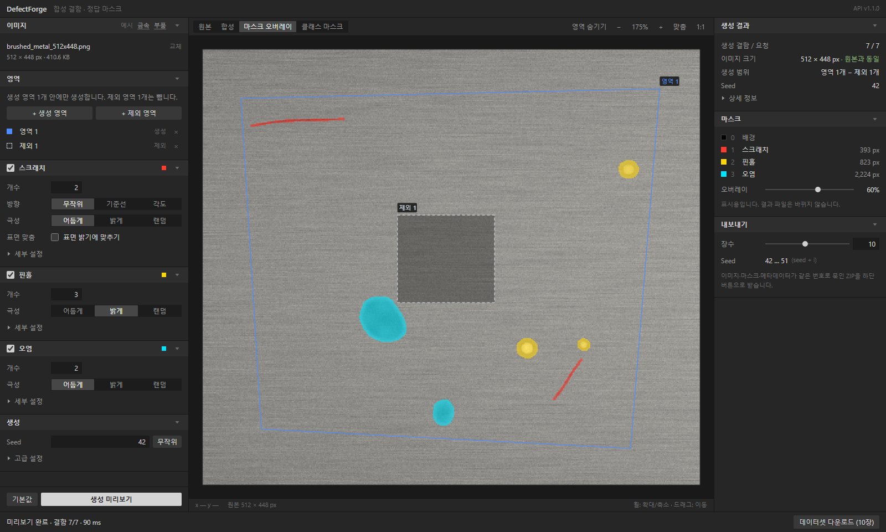
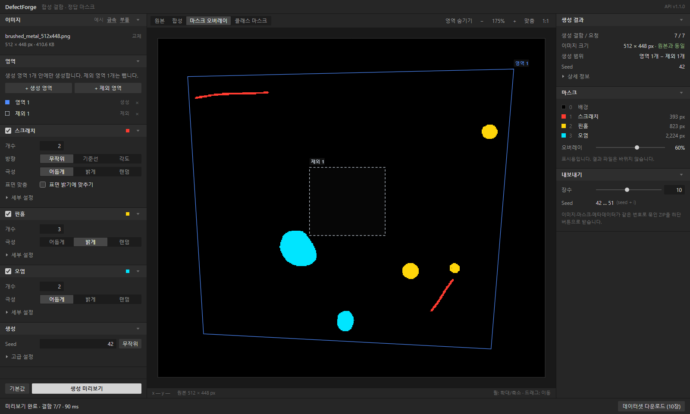
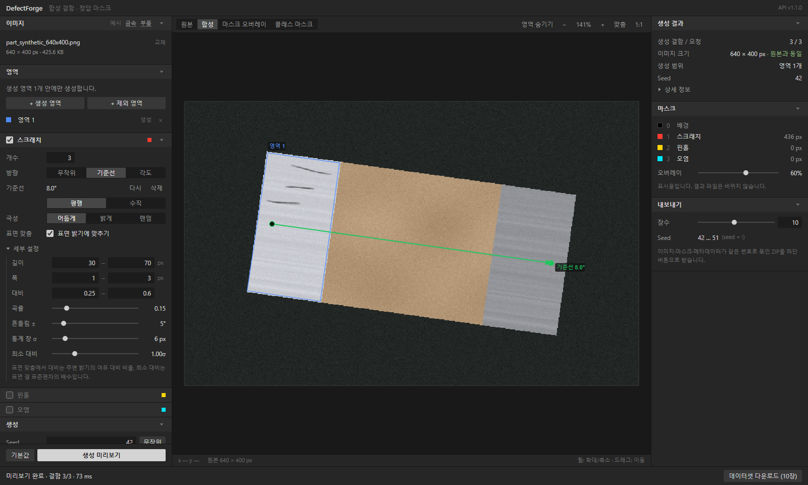

# DefectForge

정상 표면 이미지에 **합성 결함(scratch · pinhole · contamination)** 을 넣고, 합성 이미지와 **픽셀 단위로 정확히 정합되는 Segmentation 마스크**를 함께 만들어 데이터셋 ZIP으로 내려받는 로컬 웹 워크벤치입니다. GPU·DB·로그인 없이 동작합니다.

한 화면에서 이미지 → (선택) 영역 → 결함 → 생성 순서로 씁니다. 영역을 그리지 않으면 이미지 전체에 생성하고, 자주 바꾸지 않는 값은 `세부 설정`·`고급 설정`에 접혀 있어 기본값 그대로 바로 생성할 수 있습니다.
- **생성 영역 / 제외 영역**: 결함을 넣을 곳을 다각형 여러 개로 지정하고, 그 안에서 뺄 곳을 제외 영역으로 지정합니다. 모든 결함 유형에 적용됩니다.
- **스크래치 방향**: 무작위 / 사용자가 그린 기준선에 평행·수직 / 지정 각도.
- **표면 밝기에 맞추기**: 스크래치를 원본의 주변 표면 색·밝기에 맞춘 톤으로 그립니다.



| 클래스 마스크 보기 | 기준선 방향 + 표면 밝기 맞춤 스크래치 (합성 부품 예시) |
| --- | --- |
|  |  |

## 주요 기능

- **이미지 업로드**: PNG / JPEG / WebP, 드래그 앤 드롭 또는 파일 선택, 최대 10 MiB, 각 변 32–2048 px. 서버는 확장자가 아니라 실제 디코딩으로 판별하고 EXIF 회전 적용, RGB 8-bit로 정규화(알파는 흰 배경에 합성).
- **영역 편집**: 기본은 이미지 전체. `+ 생성 영역`(`P`) / `+ 제외 영역`으로 다각형을 여러 개 그리고, 선택·이름 변경·꼭짓점 드래그·변 중앙 클릭으로 점 삽입·우클릭으로 점 삭제·삭제. 확대·축소(휠, 포인터 기준)·팬과 무관하게 **원본 픽셀 좌표**로 저장됩니다. 자기 교차·면적 0 등은 즉시 안내.
- **결함 3종**: 유형별 활성화와 개수, 극성은 바로 보이고 크기·대비 등은 `세부 설정`에 있습니다. 스크래치는 방향(무작위 / 기준선에 평행·수직 / 각도 지정)과 `표면 밝기에 맞추기`를 고를 수 있습니다. 공통으로 Seed, `고급 설정`(겹침 허용, 경계 여유 거리).
- **미리보기**: 원본 / 합성 / 마스크 오버레이 / 클래스 마스크 보기, 오버레이 불투명도(시각화 전용), 원본·출력 크기, 실제 생성 개수, 클래스별 픽셀 수, 인스턴스 bbox, 처리 시간. 설정을 바꾸면 `설정 변경됨`으로 이전 결과임을 표시.
- **재현성**: 같은 이미지 + 같은 설정 + 같은 Seed → 이미지·마스크 PNG 바이트까지 동일.
- **데이터셋 ZIP**: 1–20장, i번째 샘플 seed = `seed + i`. 이미지 / 클래스 마스크 / 바이너리 마스크 / 샘플별 JSON + `manifest.json` + `README.txt`.
- **한국어 오류 안내**: 잘못된 파일, 크기 초과, 잘못된 영역·파라미터(필드별), 배치 불가능(원인별 횟수와 해결 힌트), 비어 버린 허용 영역(단계별 픽셀 수)을 설정을 잃지 않고 안내.

## 요구 사항

| 구성 | 버전 |
| --- | --- |
| Python | **3.11** (3.11.9에서 검증) |
| Node.js | **22.12 이상** (24.22.2, 26.13.1 LTS에서 검증. Vitest 5 요구사항) |
| OS | Windows 11에서 검증. macOS/Linux는 아래 명령의 가상환경 경로만 다름 |

GPU는 필요 없습니다.

## 빠른 시작

터미널 두 개에서 백엔드와 프론트엔드를 각각 실행합니다.

### 1) 백엔드 (FastAPI, http://127.0.0.1:8000)

```bash
cd backend
python -m venv .venv
# Windows (PowerShell):  .venv\Scripts\Activate.ps1
# Windows (Git Bash):    source .venv/Scripts/activate
# macOS / Linux:         source .venv/bin/activate
python -m pip install -r requirements.txt
uvicorn app.main:app --host 127.0.0.1 --port 8000
```

- API 문서(OpenAPI/Swagger): http://127.0.0.1:8000/docs
- 설정을 바꾸려면 `backend/.env.example`을 `backend/.env`로 복사해 수정(선택).

### 2) 프론트엔드 (Vite, http://127.0.0.1:5173)

```bash
cd frontend
npm install
npm run dev
```

브라우저에서 **http://127.0.0.1:5173** 을 엽니다. 백엔드 주소가 다르면 `frontend/.env.example`을 `frontend/.env`로 복사해 `VITE_API_BASE_URL`을 바꿉니다.

### 3) 사용 순서

1. 왼쪽 패널에서 이미지를 올리거나 `이미지` 제목줄의 예시(**금속** / **부품**)를 누릅니다. 예시는 모두 코드로 만든 합성 이미지입니다.
2. (선택) **영역**에서 `+ 생성 영역`(`P`)으로 결함을 넣을 곳을, `+ 제외 영역`으로 그 안에서 뺄 곳을 그립니다. 클릭으로 점 추가 → 첫 점 클릭 / 더블클릭 / `Enter`로 닫기, `Backspace` 마지막 점 삭제, `Esc` 취소, `Space`+드래그로 이동. 그리지 않으면 이미지 전체를 사용합니다. 그린 영역은 목록이나 캔버스에서 선택해 이름을 바꾸고 꼭짓점을 고칠 수 있습니다.
3. **결함**에서 유형·개수·극성을 고릅니다. 스크래치는 **방향**과 **표면 밝기에 맞추기**도 고를 수 있습니다. `기준선`을 고르면 `기준선 그리기`를 누르고 이미지에서 두 점(예: 부품의 긴 방향)을 찍은 뒤 `평행`/`수직`을 고릅니다. 크기·대비 등은 `세부 설정`에 있습니다.
4. Seed를 정하고 왼쪽 아래에 고정된 **생성 미리보기**를 누릅니다. 생성이 막히면 버튼 아래에 이유가 표시됩니다. 옆의 `기본값`은 결함·생성 설정을 처음 값으로 되돌립니다(Seed 유지).
5. 상단 탭으로 보기 모드를 바꾸고, 오른쪽에서 결과(생성 개수, 크기, 생성 범위)와 범례를 확인합니다. `상세 정보`에 허용 픽셀·방향·인스턴스 bbox가 있습니다. 캔버스의 `영역 숨기기`는 표시만 끕니다.
6. 오른쪽 **데이터셋 내보내기**에서 장수(1–20)를 정하고 하단 **데이터셋 다운로드**를 누릅니다.

## 영역과 스크래치 옵션 (config 1.1)

화면은 항상 config 1.1로 요청합니다. config 1.1은 1.0의 상위 집합이라, 영역이 없거나 하나뿐이고 경계 여유 0 · 방향 `무작위` · 표면 맞춤 꺼짐이면 1.0과 **픽셀 단위로 같은** 결과를 냅니다(`tests/test_v11_generation.py`가 1.0 골든 해시와 대조). 1.0 config는 API에서 그대로 쓸 수 있습니다.

### 규칙 요약 (계산식과 판단 근거는 [DECISIONS.md §7](DECISIONS.md))
- **허용 영역** = (생성 영역의 합집합, 없으면 이미지 전체) − 제외 영역의 합집합, 그중 경계(이미지 경계 포함)까지 거리가 `edge_margin_px`보다 큰 픽셀. 생성 영역끼리 겹치면 그냥 합칩니다. 영역 목록 순서와 이름은 결과에 영향이 없습니다.
- 모든 결함의 **전체 지지 영역(안티에일리어싱 포함)** 이 허용 영역 안에 있어야 합니다. 중심만 안에 있거나 끝이 나가는 배치는 거절하고, 경계에서 잘라내지 않습니다. 100회 실패하면 원인과 해결 방법을 담은 422를 반환합니다.
- **스크래치 방향**: 무작위 = 1.0과 같이 `angle_deg` 범위에서 균등 샘플링, 기준선에 평행 = 기준선 각도, 수직 = 기준선 + 90°, 각도 지정 = 입력값. 무작위 외에는 ±흔들림이 붙습니다. 평행/수직인데 기준선이 없으면 생성 전에 안내하고 서버도 `INVALID_REFERENCE_LINE`으로 거절합니다(방향을 추정하거나 무작위로 대체하지 않음).
- **표면 밝기에 맞추기**: 원본 이미지에서 허용 영역의 바탕(생성 영역 − 제외 영역) 안 유효 픽셀만으로 국소 평균 색·밝기·표준편차를 구하고(영역 밖 배경은 섞지 않음), 어두운 스크래치는 국소 색의 어두운 톤으로, 밝은 스크래치는 흰색 쪽으로 `대비 × 명암 여유`만큼 바꿉니다. 포화·평탄·통계 부족 영역은 정해진 대체 규칙을 쓰고 그 비율을 기록합니다. 실제 조명이나 3D 형상을 복원하는 것은 아닙니다.
- 분석은 요청당 한 번, 합성 전 **원본**에서 수행하며 ZIP의 모든 샘플이 같은 분석 결과를 씁니다.

## 테스트와 검증 결과

```bash
# 백엔드: 단위 + API 통합
cd backend
pytest -q

# 프론트엔드: 타입체크, 린트, 단위 테스트, 빌드
cd ../frontend
npm run typecheck
npm run lint
npm run test
npm run build

# 브라우저 E2E (실제 FastAPI + Vite 서버를 자동으로 띄움. 이미 실행 중이면 재사용)
npx playwright install chromium   # 최초 1회
npx playwright test
```

**2026-11-12 실행 결과** (Windows 11, Python 3.11.9, Node 26.13.1)

| 스위트 | 결과 |
| --- | --- |
| `pytest -q` (백엔드 단위·API 통합·계약·1.0 회귀) | **221 passed** (config 1.1 관련 81개 포함) |
| `npm run test` (Vitest + React Testing Library) | **61 passed** (7 files) |
| `npx playwright test` (Chromium, 작업 화면 6 + 모바일 2 + 영역·기준선 3) | **11 passed** |
| `npm run typecheck` / `npm run lint` / `npm run build` | 오류·린트 경고 0, 빌드 성공 |

`tests/test_regression_v1.py`는 config 1.1을 추가하기 전 코드에서 계산한 config 1.0 결과(PNG·메타데이터·HTTP 응답)의 해시를 고정해, 1.0이 비트 단위로 바뀌지 않았음을 확인합니다. 같은 해시로 "1.0과 같은 설정의 1.1 요청"도 같은 픽셀을 내는지 확인합니다.

E2E는 목업 없이 실제 백엔드에 요청합니다. Playwright가 `backend/.venv`의 Python으로 uvicorn을 띄우므로 먼저 백엔드 가상환경을 만들어 두세요(다른 Python을 쓰려면 `DEFECTFORGE_PYTHON` 환경변수로 경로 지정).

### 설계서 수용 기준(T01–T15) 대응

| 기준 | 검증 위치 |
| --- | --- |
| T01 PNG/JPEG/WebP 정상, 잘못된 형식·손상 파일 거절 | `test_image_io.py`, `test_api.py`(텍스트·잘린 PNG·`.png` 이름의 GIF), E2E(가짜 이미지 업로드) |
| T02 세 유형 미리보기 | `test_generation.py::test_each_type_generates_visible_defects`, E2E |
| T03 ROI(생성 영역) 없으면 전체 이미지 | `test_roi.py`, `test_generation.py::test_no_roi_uses_full_image`, `test_v11_area.py` |
| T04 ROI(허용 영역) 밖 RGB 100% 동일 | `test_masks.py`(삼각형 ROI, blur σ=8에서도), `test_v11_generation.py`(세 유형 + 제외 영역 + 경계 여유) |
| T05 같은 Seed → SHA-256 동일 | `test_generation.py`(3회 반복, 배열·PNG 바이트·메타데이터), `test_api.py` |
| T06 다른 Seed → 위치/형태 다름 | `test_generation.py::test_different_seeds_differ` |
| T07 이미지·마스크 크기 일치 | `test_masks.py`(PNG 디코드 후 비교), E2E(ZIP PNG 헤더) |
| T08 `binary == any(diff)*255` | `test_masks.py`, `test_api.py`, `test_export.py`, 무작위 설정 25종 |
| T09 `binary==0`이면 `class==0`, 범위 0..3 | 위와 동일 (+ `class>0 ⇔ binary==255`까지 검증) |
| T10 요청 개수 = 생성 개수 또는 명시적 422 | `test_generation.py`(80개 생성, 배치 불가 시 422) |
| T11 ZIP N=1/10/20 | `test_export.py`(구조·1:1 매칭·manifest·seed 규약·임시 파일 삭제), E2E(N=10 다운로드) |
| T12 10 MiB 초과, 2048 px 초과, 빈 ROI, 잘못된 파라미터 거절 | `test_api.py`, `test_image_io.py`, `test_roi.py`, Vitest, E2E |
| T13 오버레이 불투명도가 결과 파일 불변 | Vitest(스토어·컴포넌트), E2E(불투명도 변경 후 ZIP 바이트 = 미리보기 바이트) |
| T14 확대/축소 후 ROI 좌표 오차 ≤ 1 px | Vitest(Konva `Transform` 역행렬 대조, 무작위 2000회), E2E(확대·팬·휠 후 실제 클릭 / 꼭짓점 드래그 / 모바일 탭) |
| T15 Python·프론트 단위·E2E 통과 | 위 표 |

### config 1.1 (영역·스크래치 옵션) 검증 대응

| 요구 | 검증 위치 |
| --- | --- |
| 1.0과 같은 설정의 1.1 요청 = 1.0 골든 결과와 같은 PNG 바이트 | `test_v11_generation.py::test_v11_with_only_v10_features_gives_the_v10_pixels`, `test_v11_api.py` |
| 허용 영역 밖(생성 영역 밖·제외 영역·경계 여유 띠)에 픽셀 변화 없음 (세 유형 모두) | `test_v11_generation.py`(엔진과 다른 방법으로 계산한 허용 영역과 대조), `test_v11_area.py` |
| 생성 영역 합집합, 영역 없음 = 이미지 전체, 이미지 경계도 여유 기준 | `test_v11_area.py` |
| 빈 허용 영역·잘못된 다각형·ID 중복·기준선 오류 거절 | `test_v11_area.py`, `test_v11_api.py`, E2E |
| 중심은 안이지만 끝이 밖인 스크래치 거절(잘라내지 않음) | `test_v11_generation.py::test_scratch_with_centre_inside_but_ends_outside_is_rejected` |
| 무작위·평행·수직·지정 각도와 흔들림 범위, 실제 그려진 방향(PCA) | `test_v11_generation.py::test_orientation_modes_and_jitter_bounds`, `test_random_mode_…` |
| 부품 회전(0/30/90/135/172°)에 따른 방향 일관성, 기준선 점 순서 무관 | `test_v11_generation.py`, Vitest |
| 밝은/어두운 표면, 평탄·포화(흰색/검정) 표면에서 수치 정상, 색 비율 유지 | `test_v11_generation.py`, `test_surface.py` |
| 영역 밖 배경이 국소 통계에 섞이지 않음, 대체 규칙 기록 | `test_surface.py` |
| 같은 Seed 재현, 영역 순서·이름 변경 무관 | `test_v11_generation.py`, `test_v11_area.py` |
| 미리보기 = ZIP 첫 샘플, ZIP에 영역·해시·분석 정보 유지 | `test_v11_api.py`, E2E |
| 이미지 교체 시 오래된 상태·응답 폐기, 쓰지 않는 기준선은 결과를 '변경됨'으로 만들지 않음 | Vitest(`areas.test.ts`), E2E |
| 확대·팬 후 영역·기준선 좌표 정확(≤1px), 실제 UI의 영역 지정 → 생성 → ZIP | E2E(`tests/regions.spec.ts`) |

> 위 검증은 모두 **절차적 합성 이미지**(`backend/scripts/synthetic_part.py`의 칩 부품 형태 fixture, 텍스처 표면)로 수행했습니다. 실제 부품·NG 이미지로는 검증하지 않았으므로, 실제 결함과의 유사성이나 검사 성능 향상은 검증된 사항이 아닙니다.

## 성능 (1024×1024, CPU)

```bash
cd backend
python scripts/benchmark_preview.py --runs 20                               # config 1.0 기본 설정
python scripts/benchmark_regions.py --runs 20 --zip-runs 5 --zip-count 10   # config 1.1 영역 + 표면 맞춤
```

2026-11-12 측정 — AMD Ryzen 계열 데스크톱 CPU(AMD64 Family 25 Model 97), Windows 11, Python 3.11.9, NumPy 2.4.6, OpenCV 4.14.0.

**기본 설정** (config 1.0, 스크래치 2 + 핀홀 3 + 오염 2, Seed 20개)

| 구간 | 중앙값 | p90 |
| --- | --- | --- |
| 합성 엔진만 | **24.4 ms** | 25.8 ms |
| 미리보기 전체 (엔진 + PNG 3장 인코딩 + base64) | **236.2 ms** | 239.1 ms |

**생성 영역 + 표면 맞춤** (config 1.1, 1024×1024 합성 부품, 생성 영역 68,271 px, 스크래치 2개·기준선 평행·표면 맞춤 σ=6·여유 2px)

| 구간 | 중앙값 | p90 | 실행 횟수 |
| --- | --- | --- | --- |
| 영역 계산 (래스터화·집합 연산·거리 변환) | **9.7 ms** | 10.1 ms | 20 |
| 국소 표면 분석 (요청당 1회) | **12.4 ms** | 13.0 ms | 20 |
| 합성 (준비된 결과로 1장) | **17.8 ms** | 18.4 ms | 20 |
| 미리보기 처리 (합성 + PNG 3장 + base64) | **230.2 ms** | 234.3 ms | 20 |
| ZIP 10장 (준비 1회 + 10장 생성·PNG·압축) | **2,386.3 ms** | 2,490.4 ms | 5 |

1.1 `/preview` 한 번의 서버 처리 시간은 대략 영역 계산 + 분석 + 미리보기 처리입니다. 두 경우 모두 시간의 대부분은 PNG 인코딩입니다.

## API

모든 경로는 `/api/v1` 아래에 있고, 오류는 항상 `{"error": {"code", "message", "details"}}` 형식입니다.

| 메서드·경로 | 입력 | 출력 |
| --- | --- | --- |
| `GET /api/v1/health` | – | `{"status":"ok","version":"1.1.0"}` |
| `POST /api/v1/preview` | multipart: `file`, `config`(JSON 문자열, `version` "1.0" 또는 "1.1") | `image_png_base64`, `class_mask_png_base64`, `binary_mask_png_base64`(data URI 접두어 없음), `metadata`, `processing_ms` |
| `POST /api/v1/export` | multipart: `file`, `config`, `sample_count`(1–20) | `application/zip` (`defectforge_dataset.zip`) |

```bash
# 저장소 루트에서
curl -s http://127.0.0.1:8000/api/v1/health

curl -s -X POST http://127.0.0.1:8000/api/v1/preview \
  -F "file=@frontend/public/samples/brushed_metal_512x448.png" \
  -F "config=<examples/configs/scratch.json"

curl -s -X POST http://127.0.0.1:8000/api/v1/export \
  -F "file=@frontend/public/samples/brushed_metal_512x448.png" \
  -F "config=<examples/configs/pinhole.json" \
  -F "sample_count=5" -o defectforge_dataset.zip

# config 1.1: 합성 부품 예시의 왼쪽 전극 영역에만, 기준선 방향 + 표면 맞춤 스크래치
curl -s -X POST http://127.0.0.1:8000/api/v1/preview \
  -F "file=@frontend/public/samples/part_synthetic_640x400.png" \
  -F "config=<examples/configs/regions_scratch.json"
```

| HTTP | 코드 | 상황 |
| --- | --- | --- |
| 400 | `MISSING_FIELD`, `INVALID_JSON`, `BAD_REQUEST` | 필수 필드 누락, config JSON 문법 오류, 본문 해석 불가 |
| 413 | `FILE_TOO_LARGE` | 업로드 10 MiB 초과 |
| 422 | `INVALID_IMAGE`, `UNSUPPORTED_IMAGE_FORMAT`, `IMAGE_DIMENSIONS_OUT_OF_RANGE` | 디코딩 불가, PNG/JPEG/WebP 아님(16비트 포함), 크기 범위 밖 |
| 422 | `INVALID_CONFIG`, `INVALID_ROI`, `INVALID_SAMPLE_COUNT` | 파라미터·ROI·장수 오류 (`details.errors`에 필드별 한국어 메시지) |
| 422 | `DEFECT_PLACEMENT_FAILED` | 100회 시도해도 배치 불가 (`details.rejections`에 원인별 횟수) |
| 422 | `INVALID_REGION`, `INVALID_REFERENCE_LINE`, `EMPTY_ALLOWED_AREA` | (1.1) 영역 다각형·ID 중복, 기준선 누락·범위·길이, 허용 영역이 비어 있음(`details`에 단계별 픽셀 수) |
| 429 | `SERVER_BUSY` | 동시 생성 작업 상한 초과 |
| 500 | `INTERNAL_ERROR` | 서버 내부 오류 (경로·트레이스 비노출) |

### config 형식

```json
{
  "version": "1.0",
  "seed": 42,
  "roi": [[40, 40], [460, 40], [460, 400], [40, 400]],
  "allow_overlap": false,
  "defects": [
    { "type": "scratch", "count": 2,
      "params": { "length_px": [45, 110], "width_px": [1, 3], "angle_deg": [0, 180],
                  "contrast": [0.2, 0.65], "polarity": "dark", "curvature": 0.2 } }
  ]
}
```

- `roi`: `null`이면 전체 이미지. 원본 픽셀 공간의 정수 `[x, y]`, 3–256점, 자기 교차 없는 단순 다각형. 경계 픽셀 포함.
- `defects`: 1–3개, 유형별 최대 1회(개수는 `count`). 배열 순서대로 적용되며 겹치면 나중 유형이 라벨을 가집니다.
- `[min, max]` 범위 값은 인스턴스마다 균등 샘플링. `polarity`는 `dark | bright | random`(random은 인스턴스마다 결정).
- 예시: [`examples/configs/`](examples/configs) (`scratch.json`, `pinhole.json`, `contamination.json`, `regions_scratch.json` — 각 예시 이미지에서 생성되는지 테스트로 확인)

| 유형 | 파라미터 (범위 · 기본값) |
| --- | --- |
| `scratch` | `count` 1–20 · 2, `length_px` 8–512 · [40,120], `width_px` 1–20 · [1,3], `angle_deg` 0–180 · [0,180], `contrast` 0.05–1 · [0.25,0.6], `curvature` 0–1 · 0.15, `polarity` · dark |
| `pinhole` | `count` 1–30 · 3, `radius_px` 1–30 · [2,6], `irregularity` 0–1 · 0.3, `contrast` 0.05–1 · [0.35,0.85], `rim_strength` 0–1 · 0.2, `polarity` · bright |
| `contamination` | `count` 1–30 · 2, `radius_px` 2–80 · [8,24], `irregularity` 0–1 · 0.5, `opacity` 0.1–1 · [0.3,0.7], `blur_sigma` 0–8 · 1.5, `polarity` · dark |

기본 `seed`는 42(범위 0 ~ 2³²−1). 한계값·기본값의 단일 출처는 백엔드 `app/schemas/generation.py`이며, 프론트의 `frontend/src/types/limits.json`이 같은지 `tests/test_contract.py`가 검사합니다.

### config 1.1 형식 (영역·스크래치 옵션)

1.0과 같은 `defects`에 영역·경계 여유·기준선이 더해집니다. `roi` 대신 `regions`를 씁니다(1.0의 ROI 하나 = 생성 영역 하나).

```json
{
  "version": "1.1",
  "seed": 42,
  "allow_overlap": false,
  "regions": [
    { "id": "electrode_a", "name": "전극 A", "kind": "include", "polygon": [[117, 72], [218, 86], [191, 281], [89, 267]] },
    { "id": "keep_out", "name": "제외 1", "kind": "exclude", "polygon": [[140, 160], [170, 160], [170, 190], [140, 190]] }
  ],
  "edge_margin_px": 2,
  "reference_line": { "start": [123, 172], "end": [516, 227] },
  "defects": [
    { "type": "scratch", "count": 2,
      "params": { "length_px": [30, 70], "width_px": [1, 2.5], "contrast": [0.25, 0.5], "polarity": "dark", "curvature": 0.1,
                  "orientation": { "mode": "parallel", "jitter_deg": 5 },
                  "shading": { "mode": "local", "window_sigma_px": 6, "min_texture_ratio": 1.0 } } },
    { "type": "pinhole", "count": 3 }
  ]
}
```

| 필드 | 의미 · 범위 · 기본값 |
| --- | --- |
| `regions[]` | 0–32개 · 없음(= 이미지 전체). `id`(영문·숫자·`_`·`-`, 1–64자, 고유), `name`(표시용 1–40자, 결과에 영향 없음), `kind` = `include`(생성 영역) \| `exclude`(제외 영역), `polygon`(1.0 ROI와 같은 규칙) |
| `edge_margin_px` | 0–50 · 0. 허용 영역 경계(이미지 경계 포함)에서 이 거리 이하인 픽셀에는 결함을 두지 않음 |
| `reference_line` | 두 점(원본 픽셀 정수), 4px 이상 · `null`. 스크래치 방향이 `parallel`/`perpendicular`일 때만 필요 |
| `defects[]` | 1.0과 같음. 스크래치 `params`에만 아래 두 항목이 추가됨 |
| `scratch.params.orientation` | `mode` = `random`(기본, `angle_deg` 범위 사용 = 1.0) · `parallel` · `perpendicular` · `absolute`, `angle_deg` 0–180 · 0(absolute용), `jitter_deg` 0–45 · 5(random 외) |
| `scratch.params.shading` | `mode` = `fixed`(기본, 1.0 외관) · `local`(표면 밝기 맞춤), `window_sigma_px` 2–32 · 6, `min_texture_ratio` 0–4 · 1.0 |

각도는 원본 이미지 좌표(x 오른쪽, y 아래) 기준 [0, 180)°입니다. `contrast`는 `local`에서 "국소 명암 여유 대비 비율", `fixed`에서 "검정/흰색으로 섞는 비율"입니다.

## 출력 데이터 형식

```
defectforge_dataset.zip
├── README.txt                    # 클래스 값, 파일 매칭, 합성 데이터 한계
├── manifest.json                 # 생성 일시(UTC), 개수, 클래스 정의, seed 규약, 원본 SHA-256, config, 파일 목록
├── images/image_0001.png         # RGB 8-bit, 원본과 같은 W×H
├── masks/mask_0001.png           # 단일 채널 8-bit 회색조, 픽셀값 = 클래스 ID
├── binary_masks/binary_0001.png  # 단일 채널 8-bit, 0 = 변경 없음, 255 = 변경됨
└── metadata/image_0001.json      # 샘플별 메타데이터
```

- 같은 번호(0001부터)끼리 1:1 대응합니다. i번째 샘플(0부터)의 seed = `base_seed + i`.
- **클래스 값**: `0 = background`, `1 = scratch`, `2 = pinhole`, `3 = contamination`. 팔레트 PNG가 아니라 회색조 값 자체가 클래스 ID라 일반 뷰어에서는 거의 검게 보입니다.
- **마스크 의미**: 합성으로 **실제 RGB 값이 바뀐 픽셀**. `binary_mask == any(image != 원본) * 255`가 항상 성립하고, `binary_mask == 0`인 곳의 `class_mask`는 0, 그 외는 1–3입니다. ROI 밖 픽셀은 원본과 완전히 같습니다.
- **metadata 주요 필드**: `seed`, `source_sha256`(업로드 원본 바이트), `width`, `height`, `class_map`, `roi`, `roi_pixel_count`, `requested_count`, `generated_count`, `changed_pixel_count`, `class_pixel_counts`, `config`, 그리고 `instances[]` — 인스턴스별 `type`, `class_id`, `bbox_xyxy`(포함 픽셀 인덱스), `center_xy`, `changed_pixel_count`, `attempts`, 실제 샘플링된 `params`(길이·폭·각도·대비·극성·반지름·색 등).
- **config 1.1** metadata에는 1.0의 `roi`·`roi_pixel_count` 대신 다음이 들어갑니다(샘플별 metadata와 `manifest.json` 모두): `area`(영역별 다각형·픽셀 수·마스크 SHA-256, 순서 무관 기하 해시, 이미지 전체 여부, 생성·제외·허용 픽셀 수와 허용 영역 마스크 SHA-256, 경계 여유, 래스터화·여유 규칙), `reference_line`(점·각도·길이), `surface_analysis`(표면 맞춤 시 대체·포화·평탄 비율과 전역 통계), `algorithm_versions`. 스크래치 인스턴스 `params`에는 방향 모드, 실제 각도(기준·오프셋), 경계까지 최소 거리, 표면 맞춤 시 지지 영역의 국소 색·밝기·표준편차·명암 여유·ΔL 평균/최대·텍스처 하한·대체 비율이 기록됩니다.

## 환경 변수

| 위치 | 변수 | 기본값 |
| --- | --- | --- |
| backend | `CORS_ORIGINS` | `http://localhost:5173,http://127.0.0.1:5173` |
| backend | `MAX_UPLOAD_MIB` | `10` |
| backend | `MAX_IMAGE_DIM` | `2048` |
| backend | `MAX_EXPORT_COUNT` | `20` |
| backend | `MAX_CONCURRENT_JOBS` / `JOB_WAIT_SECONDS` | `2` / `15` |
| backend | `EXPORT_TMP_DIR` | OS 임시 폴더 (32 MiB 넘는 ZIP만 디스크 사용, 자동 삭제) |
| frontend | `VITE_API_BASE_URL` | `http://127.0.0.1:8000` |

## 프로젝트 구조

```
backend/
  app/main.py                FastAPI 앱 팩토리, CORS, 요청 크기 가드, 500 처리
  app/config.py              환경 변수 설정
  app/error_codes.py         오류 코드·HTTP 상태 단일 정의
  app/api/routes.py          /health, /preview, /export, 동시성 제한
  app/api/errors.py          공통 오류 포맷, 검증 오류 한국어 번역
  app/schemas/generation.py  Pydantic 스키마, LIMITS/DEFAULTS
  app/core/image_io.py       업로드 읽기·디코딩·정규화·PNG 인코딩
  app/core/roi.py            ROI(와 1.1 영역) 다각형 검증·래스터화
  app/core/compositor.py     효과 적용과 마스크 규약 보장 (두 버전 공용)
  app/core/generation.py     1.0 생성 파이프라인, 공용 배치 루프·메타데이터 (FastAPI 비의존)
  app/core/regions.py        1.1 생성/제외 영역 → 허용 영역·통계 영역·경계 거리·해시
  app/core/surface.py        1.1 국소 표면 분석 (원본, 정규화 컨볼루션)
  app/core/generation_v11.py 1.1 파이프라인 (기준선·방향 해석, 준비/생성)
  app/core/pipeline.py       버전별 준비·샘플러 (preview/export 공용)
  app/core/exporter.py       데이터셋 ZIP
  app/defects/               DefectGenerator 기반 클래스, 3종 생성기, 1.1 스크래치(방향·표면 맞춤), 래스터 헬퍼
  app/inference/base.py      V2용 InferenceAdapter 인터페이스(구현 없음)
  scripts/                   예시 이미지·합성 부품 fixture 생성, 성능 측정
  tests/                     pytest 221개 (1.0 회귀 해시 포함)
frontend/
  src/App.tsx                3패널 레이아웃(모바일 세로 스택)
  src/components/            ImageUploader, AreaEditor(영역 패널·꼭짓점 편집·영역/기준선 캔버스 레이어), PreviewCanvas,
                             DefectControls(결함별 패널·스크래치 방향·생성 설정·하단 생성 버튼), MaskLegend, GenerationSummary,
                             ExportPanel, StatusBar, Toast, Header, ui(접히는 패널·라벨/값 행·입력)
  src/styles/index.css       무채색 색 토큰과 공용 컨트롤 스타일
  src/store/                 Zustand 작업 상태 (영역·기준선 포함)
  src/api/client.ts          fetch 래퍼(AbortController)
  src/lib/                   좌표 변환, 영역·기준선 그리기 동작, 영역·마스크 색상, 이미지 파일 검사
  src/types/                 타입, Zod 스키마, limits.json
  tests/                     Playwright E2E (workspace.spec.ts, regions.spec.ts)
examples/configs/            예시 config 4종 (1.0 × 3, 1.1 × 1)
docs/MVP_SPEC.md             원본 설계서
DECISIONS.md                 설계서에 없던 구현 판단과 이유
```

## 확장

- **결함 유형 추가**: `app/defects/base.py`의 `DefectGenerator`를 상속해 `render()`에서 알파 레이어(효과)만 반환하고, 파라미터 스키마를 `app/schemas/generation.py`에 추가한 뒤 `app/defects/__init__.py`에 등록합니다. 이미지 범위·ROI·겹침·실제 변화 검사와 마스크 규약은 compositor가 공통으로 처리합니다.
- **모델 추론(V2)**: `app/inference/base.py`의 `InferenceAdapter` 프로토콜이 ONNX Runtime / PatchCore 어댑터 연결 지점입니다. MVP에서는 인터페이스만 있습니다.
- **Diffusion 인페인팅(V3)**: 생성기가 효과를 "제안"하고 compositor가 실제 변경 픽셀로 마스크를 만드는 구조라, 인페인팅 결과도 같은 규약으로 마스크를 얻을 수 있습니다.
- **영역·표면 맞춤의 후속 방향**(우선순위 순, 아직 구현하지 않음): 제품·촬영면별 레시피(영역·기준선) 저장과 기준 이미지 정렬 → 신뢰도를 포함한 국소 결 방향 추정 → 핀홀·오염의 표면 맞춤 → 실제 NG 자료로 외관 보정 → 필요성이 검증된 경우에만 분할·생성 모델. 자세한 내용은 [DECISIONS.md §7.8](DECISIONS.md).

## 알려진 한계

- **합성 데이터의 도메인 차이**: 마스크는 "합성으로 바뀐 픽셀"이며, 실제 현장 결함을 물리적으로 검증한 어노테이션이 아닙니다. 형태·분포·광학 특성이 실제 결함과 다를 수 있으므로, 이 데이터로 학습한 모델은 **반드시 실제 검사 데이터로 별도 검증**해야 합니다.
- **알고리즘 한계**: 결함은 절차적(알파 블렌딩) 모델입니다. `pinhole`은 핀홀과 비슷한 외관(pinhole-like appearance)을 흉내 낼 뿐 관통 구멍의 광학을 시뮬레이션하지 않습니다. 강한 파라미터에서 부자연스러워 보이는 것은 생성 모델이 아닌 합성 알고리즘의 한계입니다.
- 1–2 레벨처럼 눈에 띄지 않는 변화도 변경 픽셀로 마스크에 포함됩니다(규약상 의도).
- 밝기가 포화된 영역(예: 흰 배경 + `bright`)에서는 변화가 생기지 않아 422가 납니다. 극성이나 대비를 바꿔야 합니다.
- 16비트 이미지, 2048 px 초과 이미지, 영상/라인스캔, 타일링, COCO/YOLO/CVAT 내보내기는 지원하지 않습니다(설계서 범위 밖).
- **영역·스크래치 옵션 (config 1.1)**:
  - 기준선은 이미지에 하나이고 모든 스크래치가 같은 기준을 씁니다. 방향·표면 맞춤은 스크래치에만 있고, 핀홀·오염에는 영역·경계 여유만 적용됩니다.
  - 영역과 기준선은 사람이 지정합니다(자동 분할·자동 결 방향 추정·기준 이미지 정렬·레시피 저장 없음). 기준선(예: 부품의 긴 방향)은 표면 결 방향과 같은 개념이 아닙니다.
  - 표면 맞춤은 원본의 국소 평균·표준편차에 비례한 외관 규칙입니다. 반사·조명 방향·3D 형상·물리적 깊이는 모델링하지 않습니다. 통계는 모든 생성 영역(− 제외 영역)을 한 바탕으로 보고 구하므로, 서로 다른 재질을 맞닿게 각각 생성 영역으로 그리면 맞닿은 경계 근처(약 2σ)에서 두 재질의 통계가 섞입니다. 재질마다 따로 생성하려면 영역을 떨어뜨려 그리거나 요청을 나누세요.
  - 검증은 절차적 합성 이미지로만 했습니다. **실제 부품·NG 이미지로 외관 유사성이나 검사 성능 향상을 검증하지 않았습니다.**
- 겹침을 허용하면 인스턴스 bbox는 적용 시점 기준이라 나중 결함이 덮은 픽셀도 포함될 수 있습니다.
- 모바일에서는 버튼으로 확대·축소합니다(핀치 줌 없음). 영역 편집 실행 취소(undo)는 없습니다.
- 프론트 번들이 약 710 kB(gzip 216 kB)로, 대부분 Konva입니다. 로컬 도구 특성상 코드 분할은 하지 않았습니다.
- 동일 Seed의 바이트 재현성은 `requirements.txt`의 버전이 같은 환경을 전제로 합니다. 라이브러리 버전이나 플랫폼이 바뀌면 래스터화 결과가 달라질 수 있습니다.

## 자산·라이선스

- 예시 이미지 `frontend/public/samples/brushed_metal_512x448.png`와 `part_synthetic_640x400.png`는 `backend/scripts/generate_sample_image.py`가 난수로 만든 합성 이미지로, 외부 자산을 사용하지 않았습니다. 부품 예시는 칩 부품 형태의 기하 fixture이며 실제 부품 사진이 아닙니다.
- 사용한 오픈소스(FastAPI, NumPy, OpenCV, Pillow, React, Konva 등)는 각 라이선스를 따릅니다. 상업적 사용 전에 각 라이선스를 확인하세요.
- 업로드한 이미지와 결과는 서버에 저장되지 않습니다(미리보기는 메모리 처리, ZIP은 전송 후 즉시 삭제). 외부 API로 전송하지 않습니다.
